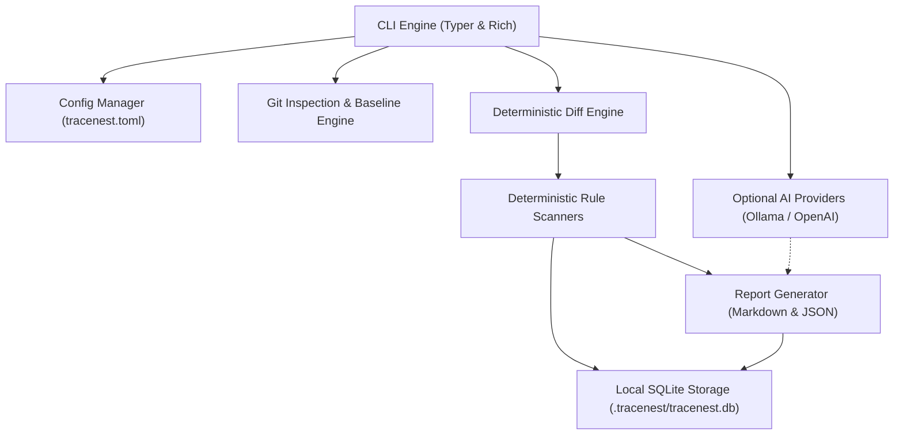

# TraceNest Architecture

TraceNest is built on a modular, local-first architecture designed for deterministic analysis, auditability, and minimal runtime dependencies.

---

## Core Components

### 1. CLI Layer (`tracenest.cli`)
Built using Typer and Rich. Handles argument parsing, terminal output formatting, tables, panels, and exit code management.

### 2. Configuration (`tracenest.config`)
Parses `tracenest.toml` using Python's standard `tomllib` (with Pydantic validation). Provides sensible defaults and validates scope paths, scanner thresholds, and provider endpoints.

### 3. Git Inspection & Baseline Engine (`tracenest.core.snapshots`)
Interacts safely with the Git CLI using subprocess argument lists (`shell=False`). Computes SHA-256 fingerprints across working tree files without buffering large files into memory.

### 4. Deterministic Diff Engine (`tracenest.core.diff`)
Parses null-delimited porcelain Git status (`-z`) to reliably track:
- Added, modified, deleted, renamed, and untracked files.
- Paths with spaces and non-ASCII filenames.
- Binary files (detected via MIME heuristic and null-byte checks).
- File size thresholds (`max_file_size_kb`).
- Path traversal and symlink confinement.

### 5. Rule Scanners (`tracenest.scanners`)
Independent of LLMs:
- **`secrets.py`**: High-entropy regex matching for AWS keys, GitHub tokens, OpenAI keys, Slack tokens, private keys, database URIs, and JWTs, with automated secret redaction.
- **`scope.py`**: Detects changes to sensitive configuration files (`.env`, `.aws`, CI workflows, certificates), dependency files, and out-of-scope files.
- **`rules.py`**: Identifies dangerous code patterns (`eval()`, `exec()`, `shell=True`, `pickle`, unsafe YAML, TLS bypass).

### 6. Storage Layer (`tracenest.storage`)
Uses local SQLite with a versioned migration system (`CURRENT_SCHEMA_VERSION = 1`). Parameterized queries protect against injection. Stores snapshots, sessions, diff statistics, and finding signatures in `.tracenest/tracenest.db`.

### 7. Optional AI Providers (`tracenest.providers`)
Optional advisory enhancement:
- Local Ollama inference or OpenAI-compatible endpoints.
- Strict privacy guard: Remote requests are blocked unless `allow_remote_data_sharing = true` is explicitly configured.
- Automatic secret redaction prior to prompt transmission.
